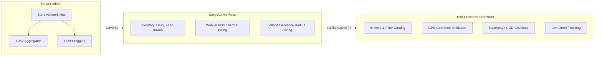

# Milkify Application Release & Versioning Documentation

## 1. Semantic Versioning Protocol
Milkify follows the **Semantic Versioning 2.0.0** standard:
$$\text{MAJOR}.\text{MINOR}.\text{PATCH}$$

- **MAJOR (vX.0.0)**: Incompatible database changes, architectural restructurings, or tenant model updates.
- **MINOR (v0.X.0)**: Backwards-compatible new features, new portal modules, or major capability additions (e.g., E-Commerce Store release).
- **PATCH (v0.0.X)**: Backwards-compatible bug fixes, UI adjustments, and performance patches.

Both `Backend/package.json` and `milkify-next/package.json` are maintained at identical version identifiers (`2.5.0`).

---

## 2. Release v2.5.0: Dairy Products & Cattle Feed E-Commerce Ecosystem

### Executive Overview
Release `v2.5.0` transforms Milkify from a standalone milk collection and dairy accounting software into a comprehensive **rural & semi-urban retail commerce platform**. Dairy admins can now digitize their physical store counter sales while simultaneously launching an online storefront for village customers.

---

## 3. Key Feature Specifications & Architecture

### A. Geofenced Village Delivery Engine
- **Business Rule**: Milk, paneer, and bulky cattle feed bags (50kg) can only be delivered within the dairy outlet's operative village clusters.
- **Mathematical Validation**: Uses the **Haversine Formula** inside `Backend/src/Store/services/geofence.service.js`:
  $$d = 2 R \arcsin\left(\sqrt{\sin^2\left(\frac{\Delta \phi}{2}\right) + \cos(\phi_1)\cos(\phi_2)\sin^2\left(\frac{\Delta \lambda}{2}\right)}\right)$$
- If customer distance exceeds `deliveryRadiusKm` and their village is not in `serviceVillages`, delivery is gracefully disabled and the customer is offered In-Store Counter Pickup.

### B. Omnichannel POS & Online Ledger
- Physical walk-in counter sales and online orders share a unified real-time stock ledger in `Backend/src/Store/models/storeProduct.model.js`.
- POS billing generates instant 2-inch/3-inch thermal receipts for farmers adjusting against their milk accounts or cash.

### C. Seamless Razorpay Integration
- Mobile numbers are pre-sanitized into strict 10-digit formats (omitting `+91`) with `readonly: { contact: true, email: true, name: true }`.
- Payment signature is cryptographically verified on the server using HMAC-SHA256 before order status transitions to `confirmed`.

---

## 4. Future Product Roadmap Plan

| Target Version | Scheduled Focus | Key Capabilities Planned |
|---|---|---|
| **v2.6.0** | **Delivery Runner Mobile PWA** | Dedicated PWA for village delivery boys with route map, OTP on delivery, and cash collection balance. |
| **v2.7.0** | **Farmer Milk-Bill Adjustment** | Direct integration allowing milk-supplying farmers to buy cattle feed on credit against their pending 15-day milk settlement cycle. |
| **v3.0.0** | **AI Feed Recommendation** | AI-driven cattle feed advisor suggesting feed combinations based on a cow's lactation stage and daily milk yield trends. |
